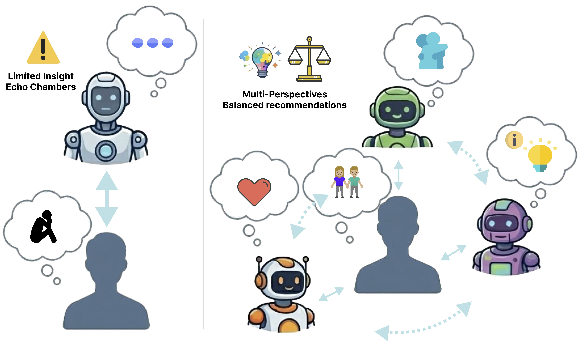

<div align="center">

# 🎭 MASCOT

### *Towards Multi-Agent Socio-Collaborative Companion Systems*



<br/>

[](https://2026.aclweb.org/)
[](https://hello-diana.github.io/MASCOT/)
[](https://arxiv.org/abs/2601.14230)
[](https://huggingface.co/papers/2601.14230)
[](LICENSE)

[](https://www.python.org/)
[](https://pytorch.org/)
[](https://huggingface.co/docs/transformers)
[](https://github.com/vllm-project/vllm)
[](https://github.com/QwenLM/Qwen3)
[](#)
[](#)

[Yiyang Wang](https://hello-diana.github.io/)¹, [Yiqiao Jin](https://ahren09.github.io/)¹, [Alex Cabral](https://a-cabral.github.io/)¹, [Josiah Hester](https://josiahhester.com/)¹

¹ Georgia Institute of Technology

</div>

---

## 📖 Overview

Social interaction shapes well-being, mental health, and cognition — yet an estimated **1 in 6** people worldwide lack the social contact they need. As large language models move from passive **tools** to active **socio-collaborative companions**, **MASCOT** is a generalizable multi-agent framework for building *multi-perspective* companions that balance **individual persona consistency** with **global discourse dynamics**.

MASCOT uses an efficient **bi-level optimization** strategy that targets two recurring failures of multi-agent LLM setups:

- 🎭 **Persona Fidelity** — a Reinforcement-Learning-from-AI-Feedback (RLAIF) pipeline fine-tunes each agent for a strict, unique persona (via **GRPO**), preventing *persona collapse* — agents losing their distinct roles and regressing to generic assistant behavior.
- 🤝 **Interaction Synergy** — a director / meta-agent policy guided by **group-level rewards** coordinates turn-taking for complementary, non-redundant dialogue, avoiding *social sycophancy* and echo chambers — agents repeating each other or agreeing unproductively instead of contributing complementary content.

> 💡 Unlike prior multi-agent systems optimized purely for task efficiency, MASCOT targets **user–agent interaction quality** in affective and collaborative settings (emotional support and workplace meetings).

> ⚠️ **Status:** this repository is a clean public release extracted from an internal research codebase. It contains the MASCOT core pipeline only — no baselines, no paper-figure/analysis tooling.

## 📊 Results

| Metric | Result |
| :--- | :---: |
| 🎭 Persona Consistency | **+14.1** |
| 🤝 Social Contribution | **+10.6** |
| 👥 Human preference (head-to-head) | **69%** |
| ⚡ Trainable parameters (LoRA, r=16) | **0.187%** |

- 🔬 **Extensive evaluation** — human, multi-judge (GPT-4o / Gemma-3-27B / Phi-4), and automatic metrics across **Empathetic Dialogues** and **QMSum** (workplace meetings), plus out-of-domain **ESConv**.

## ✨ Highlights

- 🧩 **Two-stage framework** — persona-aware behavioral alignment of individual Speakers, followed by collaborative dialogue optimization of the full group.
- 🪶 **Low-resource bi-level optimization** — harmonizes individual persona adherence with collective synergy; LoRA-only training (base weights are referenced by Hugging Face name; only LoRA adapters are ever written to disk).
- 🎬 **Director orchestration** — a Director agent selects who speaks next and issues natural-language directives specifying *speaker, action, and tone*.
- 📦 **Self-contained pipeline** — episode generation, rubric judging, preference-data construction, reward modeling, GRPO/DPO training, and evaluation, all against an OpenAI-compatible vLLM server.

## 🧩 The MASCOT Framework

MASCOT has two stages, each backed by a dedicated entry point under `src/`:

| Pipeline step | Stage | Entry point |
| :--- | :--- | :--- |
| 🎨 **Per-persona candidate generation** | 1 | `src/dataset/generate_and_annotate.py --mode individual` |
| 🧑‍⚖️ **Rubric-based LLM judging** | 1 + 2 | `src/eval/rubric_evaluator.py` |
| 🏅 **Scalar reward model** | 1 | `src/train/train_reward_model.py` |
| 🎯 **Speaker GRPO** | 1 | `src/train/train_rl.py` |
| 🗣️ **Directed episode generation** | 2 | `src/generation/mascot_episode.py` |
| 🌿 **Branching group episodes** | 2 | `src/dataset/generate_and_annotate.py --mode group` |
| 🎬 **Director optimization** | 2 | `src/train/train_group.py` |

### Stage 1 — Persona-Aware Behavioral Alignment

Speaker agents are aligned to preserve distinct personas:

1. Candidate responses are generated per persona (`src/dataset/generate_and_annotate.py --mode individual`).
2. Candidates are scored with rubric-based feedback by an LLM judge (`src/eval/rubric_evaluator.py`).
3. Preference pairs are built from the scored candidates, and a scalar **reward model** is trained on them (`src/train/train_reward_model.py`).
4. The Speaker policy is optimized with **GRPO** against the reward model, plus small format and conciseness rewards (`src/train/train_rl.py`).

### Stage 2 — Collaborative Dialogue Optimization

A **Director** agent orchestrates the conversation:

1. The Director selects which Speaker should talk next and emits a natural-language directive specifying *speaker, action, and tone*.
2. The selected Speaker responds conditioned on its persona, the directive, and the conversation history (`src/generation/mascot_episode.py`).
3. The Director is optimized with group-level rewards over full multi-turn trajectories (`src/train/train_group.py`), using branching episode data from `generate_and_annotate.py --mode group`.

## 🎭 Agent Rosters

| Domain | Datasets | Roster |
| :--- | :--- | :--- |
| 💛 **Emotional support** | Empathetic Dialogues / ESConv | *The Anchor* (emotional validator) · *The Catalyst* (action-oriented guide) · *The Beacon* (growth advocate) |
| 📋 **Meetings** | QMSum | *Minutes Scribe* · *Decision Logger* · *Action Item Captain* · *Critic* |

Personas and prompts live in `config/persona_config.py` and `src/prompts/persona_templates.py`. Simulated users can optionally carry Big Five (OCEAN) personality profiles (`src/user/simulated_users.py`).

## 🚀 Installation

```bash
pip install -e .                 # core: episode generation + rubric evaluation
pip install -e ".[train]"        # + reward model / GRPO / director training
pip install -e ".[serve]"        # + local vLLM serving
pip install -e ".[metrics]"      # + automatic non-LLM metrics (NLI, Self-BLEU)
pip install -e ".[wandb]"        # + optional Weights & Biases tracking
pip install -e ".[api-judges]"   # + optional Anthropic/Gemini judges
```

| Extra | Adds |
| :--- | :--- |
| *(core)* | Episode generation + rubric evaluation against a vLLM server |
| `train` | Reward-model / GRPO / director training (torch, trl, peft, accelerate) |
| `serve` | Local vLLM serving (`scripts/serve_vllm.py`) |
| `metrics` | Automatic non-LLM metrics — NLI contradiction, Self-BLEU |
| `wandb` | Optional Weights & Biases tracking |
| `api-judges` | Optional Anthropic / Gemini judges |

> 💡 **Weights & Biases is fully optional**: training scripts only initialize it when the `WANDB_PROJECT` environment variable is set (`WANDB_ENTITY` is also read from the environment).

> 💡 **API keys** for optional judges are read from the environment / `.env` (`OPENAI_API_KEY`, `GOOGLE_API_KEY`); nothing is hardcoded.

All commands below run from the repository root with `python -m ...`. Datasets are pulled from Hugging Face automatically (see `DATASET2HF` in `src/const.py`). Generated artifacts go to `data/` and `outputs/` (gitignored).

## ⚡ Quick Start

### 1️⃣ Serve a model with vLLM

All pipeline steps talk to an OpenAI-compatible vLLM server:

```bash
CUDA_VISIBLE_DEVICES=0,1 python scripts/serve_vllm.py \
    --model Qwen/Qwen3-8B --gpus 2 --port 8008
```

`--gpus` takes a count (`2`) or an explicit list (`0,1`); tensor parallelism is inferred. Add `--gpu-memory-utilization 0.5` on shared GPUs.

> ⚠️ **Note on endpoints:** the examples below point the Director, Speakers, and judge at one shared server. That is a convenience for smoke testing and small-scale runs. The full evaluation setup in the paper uses separate endpoints/models for the Director, Speaker, and judge — configure them via `--directive-model` / `--agent-model` (with separate `--vllm-server-url`s) and `--judge-model-name` / `--judge-vllm-server-url`.

### 2️⃣ Generate MASCOT episodes

QMSum (meeting-style):

```bash
python -m src.eval.eval_mascot_qmsum \
    --dataset QMSum --split test \
    --directive-model Qwen/Qwen3-8B --agent-model Qwen/Qwen3-8B --share-model \
    --vllm-server-url http://localhost:8008/v1 \
    --output-dir outputs
```

Empathetic Dialogues / ESConv (emotional support, with user simulation):

```bash
python -m src.eval.eval_mascot_empathetic \
    --dataset ESConv --split test \
    --directive-model Qwen/Qwen3-8B --agent-model Qwen/Qwen3-8B \
    --user-model Qwen/Qwen3-8B --share-model \
    --enable-user-simulation \
    --vllm-server-url http://localhost:8008/v1 \
    --output-dir outputs
```

Use `--dataset Empathetic` for Empathetic Dialogues. Add `--enable-big-five` (optionally with `--user-big-five-profile "High Openness" ...`) to simulate users with Big Five personality profiles. See `scripts/generate_episodes.sh`.

### 3️⃣ Generate preference data

```bash
# Stage 1: per-persona candidates + rubric annotation -> preference pairs
python -m src.dataset.generate_and_annotate \
    --mode individual --dataset ESConv \
    --model-name Qwen/Qwen3-8B \
    --num-agents-per-query 1 --score-margin 0.5 \
    --vllm-server-url http://localhost:8008/v1 \
    --output-dir data/rl

# Stage 2: branching group episodes for director training
python -m src.dataset.generate_and_annotate \
    --mode group --dataset QMSum \
    --model-name Qwen/Qwen3-8B --generation-mode branching \
    --max-samples 1000 --num-candidates 4 --num-turns 5 \
    --user-response-probability 0.5 --score-margin 0.5 --seed 42 \
    --vllm-server-url http://localhost:8008/v1 \
    --output-dir data/rl
```

> 💡 By default the rubric judge uses the same generation server; point it at a dedicated judge with `--judge-model-name` and `--judge-vllm-server-url`. See `scripts/generate_preference_data.sh`.

## 🎓 Training

All training is **LoRA-only**: base weights are referenced by Hugging Face name and only LoRA adapters are written under `outputs/`.

```bash
# 1) Speaker reward model (Stage 1)
python -m src.train.train_reward_model --dataset QMSum --model-name Qwen/Qwen3-0.6B

# 2) Speaker GRPO against the reward model (Stage 1)
python -m src.train.train_rl --algorithm grpo --dataset QMSum \
    --reward-model-path outputs/reward_model/Individual_QMSum_Qwen3-0.6B

# 3) Director / group policy (Stage 2)
python -m src.train.train_group --mode train-director-dpo \
    --episode-dataset-path data/rl/branching_QMSum_Qwen3-8B
# or: --mode train-director (GRPO), --mode train-reward-model (group reward model)
```

`src/train/merge_lora.py` merges a LoRA adapter into full weights when a merged checkpoint is needed for vLLM serving.

> 💡 **A note on π_SFT:** the paper's notation includes an SFT-initialized speaker policy (π_SFT). The GRPO pipeline in this repository initializes the Speaker LoRA directly from the base model (`config/model_config.py`) and does **not** require an SFT step; standalone SFT training is therefore not bundled here. If you want to reproduce an SFT-initialized variant, prepare an SFT LoRA checkpoint externally and point the training/generation entry points at it (e.g. `--directive-lora-path` / `--agent-lora-path` at generation time, or merge it with `src/train/merge_lora.py` and reference the merged model by path).

## 📊 Datasets

Datasets are pulled from Hugging Face automatically (see `DATASET2HF` in `src/const.py`).

| Dataset | Domain | Task |
| :--- | :--- | :--- |
| 📋 **QMSum** | Meetings | Multi-agent meeting assistance |
| 💛 **ESConv** | Emotional support | Supportive multi-agent dialogue (with user simulation) |
| 💬 **Empathetic Dialogues** | Emotional support | Supportive multi-agent dialogue (with user simulation) |

## 🧪 Evaluation

Evaluation covers MASCOT outputs only:

```bash
# Rubric evaluation of generated conversations (LLM-as-a-judge)
python -m src.eval.llm_as_a_judge \
    --input-file outputs/mascot_eval/QMSum/test/<generated-file>.jsonl \
    --dataset QMSum \
    --judge Qwen/Qwen3-8B --vllm-judge-url http://localhost:8008/v1
```

`src/eval/automatic_metrics.py` provides non-LLM redundancy metrics (NLI-based contradiction detection, Self-BLEU) over generated conversations (requires the `metrics` extra).

## 📦 Output Format

Episode generators write JSON Lines: one conversation object per line.

```jsonc
{
  "conv_id": "...",               // QMSum records use "id"/"start_idx"/"meeting" instead
  "turns": [
    {
      "turn_idx": 0,
      "directive": {              // parsed Director directive for this turn
        "agent_name": "The Anchor (Emotional Validator)",
        "action": "...",
        "tone": "..."
      },
      "agent_name": "The Anchor (Emotional Validator)",  // selected speaker
      "response": "...",          // Speaker response conditioned on the directive
      "directive_output": "..."   // raw Director model output
    }
  ],
  "agents_spoken": {"The Anchor (Emotional Validator)": 1, "...": 0},
  "metadata": { "directive_model": "...", "agent_model": "...", "num_turns": 5 }
}
```

Empathetic/ESConv records additionally carry `initial_emotion`, `final_emotion`, `emotion_trajectory`, `user_big_five`, and user-simulation turns (`"turn_type": "user"`). Rubric evaluation writes `metrics_*.json` files next to the input (or under `--output-dir`).

## 📝 Citation

If you find MASCOT useful in your research, please cite:

```bibtex
@article{wang2026mascot,
  title={MASCOT: Towards Multi-Agent Socio-Collaborative Companion Systems},
  author={Wang, Yiyang and Jin, Yiqiao and Cabral, Alex and Hester, Josiah},
  journal={arXiv:2601.14230},
  year={2026}
}
```

## ⚠️ Notes and Disclaimers

- 🚫 **No model weights are included or downloaded into the repo.** Base models are referenced by Hugging Face name; training writes LoRA adapters only.
- 🔬 **Research code.** This is not a clinical, therapeutic, or safety-certified system. The emotional-support agents are research artifacts for studying multi-agent coordination and must not be used as a substitute for professional mental-health support.
- 📦 Baselines, visualization/analysis scripts, and human-study tooling from the research codebase are intentionally not part of this release.

## ⚖️ License

The data, code, and model checkpoints are intended and licensed mainly for **research** use.

This project is released under the [Apache License 2.0](LICENSE).

<div align="center">

Made with 🤝 at Georgia Tech

</div>
